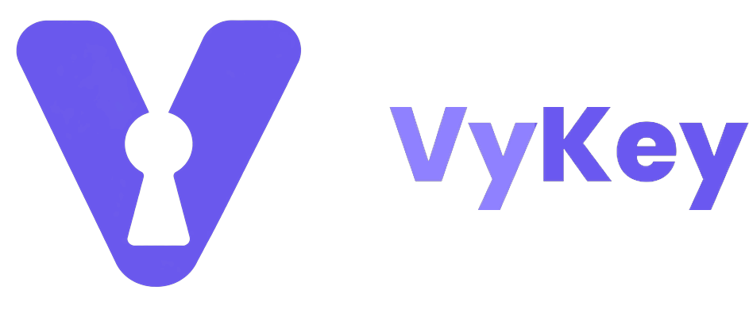

<p align="center">
  <picture>
    <source media="(prefers-color-scheme: dark)" srcset="assets/logo/vykey-lockup-lilac.png">
    
  </picture>
</p>

<p align="center">
  <b>Vault Your Keys.</b> No cloud. No account. No trust required.
</p>

<p align="center">
  <a href="https://github.com/vykey/vykey/actions/workflows/ci.yml"></a>
  <a href="LICENSE"></a>
  
</p>

---

**vykey** is a password manager that lives on your computer, not in someone's
cloud. Passwords, cards, 2FA codes and notes are kept in one encrypted file
on your own disk: no account, no subscription, no server, no telemetry.
Open it in a fast native desktop app or right in your terminal.

## Why vykey

- **Yours, offline.** Your vault never leaves your machine. Back it up,
  move it or sync it however you like: it is a single file.
- **Native and light.** Written in Rust with a native UI ([Slint](https://slint.dev)),
  not a browser in disguise. No Electron, no JavaScript, about 30 MB of RAM.
- **Desktop and terminal.** The same vault opens in the desktop app and in
  `vy`, a full-screen terminal client for people who live in a shell.
- **Unlock with a finger.** On Linux, touch the fingerprint reader instead
  of typing the master password, just like `sudo`.
- **Strong, boring crypto.** Argon2id and AES-256-GCM. Every field of every
  entry is encrypted, titles included.

|                                  | vykey | pass | gopass | Bitwarden |
|----------------------------------|:-----:|:----:|:------:|:---------:|
| Works without a cloud or account | ✅ | ✅ | ✅ | ❌ |
| Encryption without GPG setup     | ✅ | ❌ | ❌ | ✅ |
| Built-in 2FA (TOTP) codes        | ✅ | add-on | ✅ | paid plan |
| Entry names encrypted            | ✅ | ❌ | ❌ | ✅ |
| Whole vault in a single file     | ✅ | ❌ | ❌ | ❌ |
| Native desktop app               | ✅ | ❌ | ❌ | Electron |
| Full-screen terminal UI          | ✅ | ❌ | ❌ | ❌ |

<sub>pass and gopass keep one GPG-encrypted file per entry, so entry names
show up as file names. Corrections welcome.</sub>

## Features

- **Logins** with live 2FA (TOTP) codes and a password generator with a
  strength meter
- **Payment cards** with card-number validation, card brand and expiry
  warnings
- **Secure notes**, favourites and coloured folders
- **Several vaults**, each with its own master password
- **Security audit**, fully offline: weak, reused and old passwords, and
  accounts without 2FA
- **Auto-lock** after inactivity and a clipboard that clears itself after
  30 seconds
- **Fingerprint unlock** on Linux (fprintd), limited to a day and gone after
  a reboot
- **Import from Bitwarden** (CSV)
- **Light and dark themes**, English and Russian interface

## Security in a nutshell

Your master password is stretched with Argon2id (64 MB of memory per guess)
into a key that unlocks the vault's random data key. Every field is
encrypted separately with AES-256-GCM. The master password is never stored,
and changing it takes a moment because the entries do not need re-encrypting.

The format is open and documented in [docs/vault-format.md](docs/vault-format.md).
What vykey does *not* protect against (a weak master password, malware
running as you while the vault is open) is spelled out in
[docs/usage.md](docs/usage.md#fingerprint-unlock-linux).

## Get started

vykey is developed and tested on Linux. Prebuilt packages are on the way;
for now, build it with [Rust](https://rustup.rs):

```sh
git clone https://github.com/vykey/vykey && cd vykey
cargo build --release -p vykey-desktop -p vykey-cli
./target/release/vykey   # desktop app
./target/release/vy      # terminal client
```

On Linux you need the `fontconfig` and `libxkbcommon` development headers.

Moving over from Bitwarden? `vy import bitwarden.csv`. Coming from kyp, the
Go predecessor of vykey? Your database opens as is: see
[Migrating from kyp](docs/usage.md#migrating-from-kyp).

More in the [user guide](docs/usage.md): terminal shortcuts, fingerprint
unlock, configuration.

## Roadmap

Next on the list:

- **Packages and releases** for Linux (AppImage / Flatpak), then macOS and
  Windows
- **Export** to an open format, so you can always take your data elsewhere
- **Touch ID and Windows Hello** unlock
- **Trash and password history**, to undo a deletion or a password change
- **Custom fields and attachments**
- **More imports**: KeePass, 1Password, browsers
- **Browser autofill** and **sync** between your own devices, without a
  vendor cloud

Ideas and bug reports are welcome in [issues](https://github.com/vykey/vykey/issues).

## For developers

A Cargo workspace of four crates:

```
crates/vykey-core       vault format, crypto, storage, TOTP, audit (no UI)
crates/vykey-desktop    desktop app (Slint), binary `vykey`
crates/vykey-cli        terminal client (ratatui), binary `vy`
crates/vykey-biometric  fingerprint unlock (fprintd + kernel keyring)
```

```sh
cargo run -p vykey-desktop
cargo test --workspace
```

Build details, CI checks and how to add a translation are in
[docs/development.md](docs/development.md); the file format is in
[docs/vault-format.md](docs/vault-format.md).

## License

[MIT](LICENSE). Bundled fonts (Manrope, JetBrains Mono): SIL OFL 1.1. Icons:
Font Awesome Free (CC BY 4.0) and Lucide (ISC).
